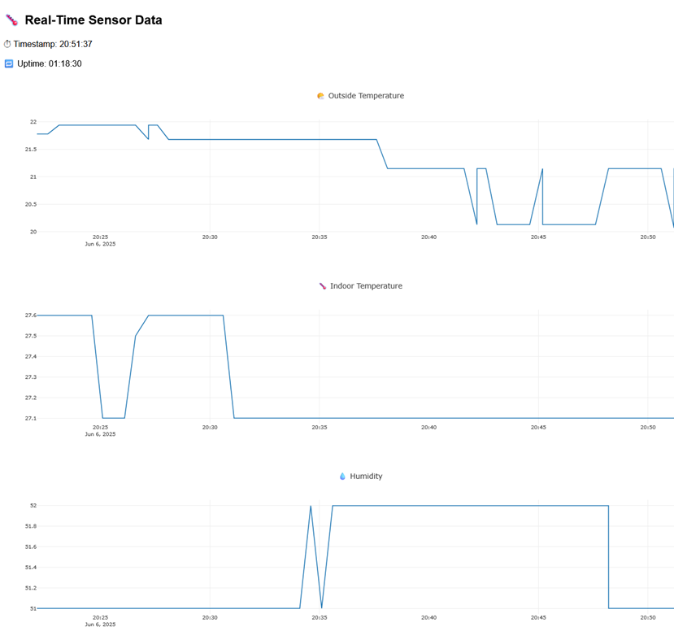
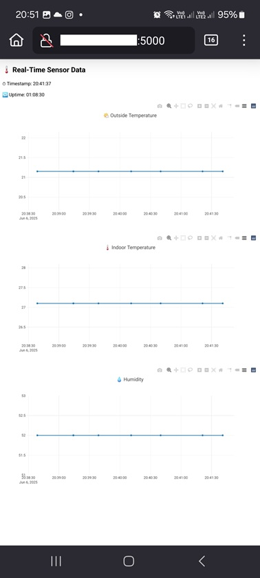

After a bunch of updates and some solid troubleshooting, I think I’m finally reaching the finish line with **ESP32 Mark0**.

This project has grown a lot since it started. What began as a simple embedded experiment turned into a full IoT setup — complete with a web dashboard, data communication, and custom hardware. Today was especially productive.

---

## 🔧 Final Touches and Fixes

One of the first things I tackled was cleaning up how often different parts of the code update. Previously, it was a bit messy — everything ran on the same interval. Now I’ve split them up so each part can update at a more sensible pace:

```cpp
const unsigned long BLYNK_INTERVAL = 5 * 60 * 1000;     // 5 minutes  
const unsigned long WEATHER_INTERVAL = 5 * 60 * 1000;   // 5 minutes  
const unsigned long EINK_INTERVAL = 3 * 60 * 1000;      // 3 minutes  
const unsigned long FLASK_INTERVAL = 30 * 1000;         // 30 seconds  
```

Much cleaner. Now, things like the E-Ink display or Blynk updates don't crowd each other or flood the network.

---

## 🌐 Flask + Web Dashboard

The big highlight today was getting the web dashboard working. I used **Flask** and **Flask-SocketIO** to set up a live interface that shows data from the ESP32. The ESP sends info over Wi-Fi, and Flask picks it up and displays it on the web.

Of course, getting everything to talk to each other wasn’t totally smooth — my PC is on a wired LAN, and the ESP32 is on Wi-Fi, so there were some annoying network issues to untangle. But once I got them talking... it just worked!

The web interface came up, data started flowing, and the layout started looking pretty slick. There was a moment of confusion over which temperature was "inside" and which was "outside" — but that was fixed pretty quickly.

Here’s how it looked on my monitor:



And here’s a shot from my phone:



---

## 📝 Repo Cleanup

Also took a bit of time to clean up the repo:

- Updated the `README.md` to reflect the current structure and environment (Arduino IDE, USB-C, Flask, etc.)
- Updated the `LICENSE` for clarity

Small but important stuff, especially if anyone else ends up using this project.

---

## 🤯 Reflecting on Mark0

At this point, I feel like I’ve squeezed pretty much *everything* I can out of Mark0. It’s impressive how much I was able to learn and build with just an ESP32, some basic components, and a custom PCB.

From hardware design in KiCad, to live web updates over Wi-Fi — this board delivered way more than I expected.

---

## ⏭️ What’s Left

There are just two final things I want to wrap up before truly calling Mark0 “done”:

- [ ] Get the Python/Flask program running as a background service (so it survives reboots)
- [ ] Make the webpage store and show some **history** of the data (e.g. temperature trends)

Once that’s in place, I’ll be ready to start thinking about **Mark1** — and I already have ideas brewing 😎

Thanks for following along!

— Z
