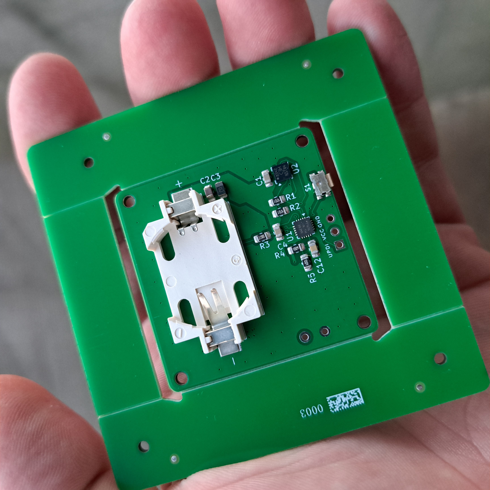
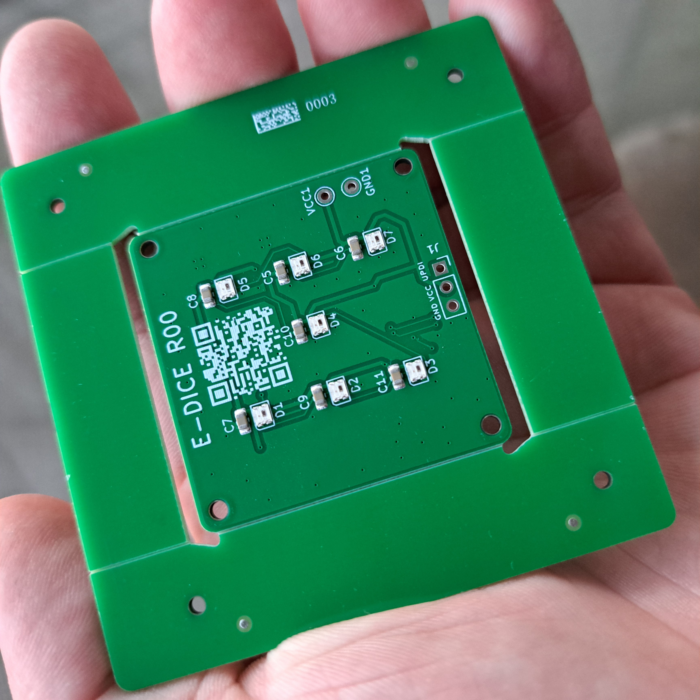

---
layout: post
title: "e-Dice - PCB arrival and first code - Part 3"
date: 2026-06-29 12:00:00 +0200
tags: [attiny1616, pcb, assembly, arduino, vsc, platformio, jlcpcb, hardware]
categories: [projects]
image:
  path: /assets/img/edice/part3_cover.png

---

Waiting game is over. The package from JLCPB arrived and I'm happy as a clam! Colors are as they supposed to be (well, it's green...), mask is legible - QR can be easily scanned, 0805 parts are nicely soldered and most importantnly VQFN chips are in their spots and in correct orientation! Thanks a lot JLCPB (#notsponsored).

<div style="display: flex; gap: 10px;">
  
  
</div>

---

## 1. The Smoke Test: Waking up the ATtiny1616

Before writing any complex LED animations, we need to know if the silicon actually survived the manufacturing and reflow process. For the modern ATtiny 0/1/2 series, the de facto standard for flashing is the UPDI interface. To talk to it, I used a standard **FT232RL** USB-to-serial adapter configured for SerialUPDI. 

*(A quick hardware note: I double-checked my FTDI module to ensure the RTS and DTR pins were completely disconnected. Some modules have weird reset behaviors on these pins, and we strictly only need VCC, GND, and the single UPDI data line.)*

For this very first "smoke test," I deliberately put VS Code aside and fired up the classic **Arduino IDE**. Not because it's a better editor, but for one strategic reason: Spence Konde's **megaTinyCore**. 

This core is incredibly well-optimized, uses a proven `avrdude` toolchain, and has the fuse settings completely dialed in. When bringing up a custom, untested PCB, the rule is simple: limit the variables. If it fails to flash in Arduino IDE with megaTinyCore, I know for a fact it's a hardware issue, not a missing line in a `platformio.ini` file.

The setup was straightforward:
1. Added the `megaTinyCore` URL to the Boards Manager and installed it.
2. Selected **Board: ATtiny1616**.
3. Set the **Clock to 20 MHz internal** (We will aggressively downclock this to 5 or 10 MHz later to save the CR2032 coin cell, but 20 MHz is fine for a wired test).
4. Selected **Programmer: SerialUPDI**.

I wrote a completely blank sketch with an empty `setup()` and `loop()`. 

```cpp
void setup()
{
}

void loop()
{
}
```

With UPDI, you can't just click the standard upload button; you have to trigger **Upload Using Programmer** (`Ctrl + Shift + U`).

I held my breath, hit the shortcut, and watched the console. A few seconds later, the terminal spit out the golden words:

`Device signature = 0x1E9421`

No magic smoke. No connection timeouts. The silicon is officially alive. 🎉 With the hardware validated, it was time to close Arduino IDE for good, boot up PlatformIO, and actually make this thing shine.


```text
Sketch uses 362 bytes (2%) of program storage space. Maximum is 16384 bytes. 
Global variables use 10 bytes (0%) of dynamic memory, leaving 2038 bytes for local variables. Maximum is 2048 bytes.
SerialUPDI 
UPDI programming for Arduino using a serial adapter 
Based on pymcuprog, with significant modifications 
By Quentin Bolsee and Spence Konde 
Version 1.3.1 - Aug 2025 
Using serial port COM4 at 230400 baud. 
Target: attiny1616 
Set fuses: ['0:0b00000000', '2:0x02', '6:0x04', '7:0x00', '8:0x00'] 
Action: write File: C:\Users\zdene\AppData\Local\arduino\sketches\AC68D9E02D725AFF41C285736D825DDE/sketch_jun21a.ino.hex 
Pinging device... 
Ping response: 1E9421 
Setting fuse 0x0=0x0 
Writing literal values... 
Verifying literal values... 
Action took 0.01s 
Setting fuse 0x2=0x2 
Writing literal values... 
Verifying literal values... 
Action took 0.01s 
Setting fuse 0x6=0x4 
Writing literal values... 
Verifying literal values... 
Action took 0.01s 
Setting fuse 0x7=0x0 
Writing literal values... 
Verifying literal values... 
Action took 0.01s 
Setting fuse 0x8=0x0 
Writing literal values... 
Verifying literal values... 
Action took 0.01s 
Finished writing fuses. 
Chip/Bulk erase, 
Memory type eeprom is conditionally erased (depending upon EESAVE fuse setting) 
Memory type flash is always erased Memory type lockbits is always erased 
... 
Erased. 
Action took 0.01s
Writing from hex file... 
Writing flash... 
[                                                  ] 
[========                                          ] 1/6 
[================                                  ] 2/6 
[=========================                         ] 3/6
[=================================                 ] 4/6 
[=========================================         ] 5/6 
[==================================================] 6/6 
Action took 0.05s Verifying... 
Verify successful. 
Data in flash matches data in specified hex-file Action took 0.02s
```

---

## 2. Let there be Neon: First code in VS Code

[Odstavec 3: First program in VSC to see the LEDs work. Přechod na dospělejší IDE (VS Code / PlatformIO). Napsání prvního zkušebního kódu pro rozsvícení WS2812B-2020 v daisy chainu. Narazil jsi na nějaký problém s časováním nebo knihovnou? Jak to vypadalo, když se ten cyberpunkový design poprvé rozsvítil?]


With the "smoke test" successfully out of the way, it was time to leave the Arduino IDE behind and move to a proper development environment: **Visual Studio Code with PlatformIO (PIO)**. 

The goal for this step wasn't just to make the LEDs blink, but to lay down a solid, professional architecture for the rest of the project.

### The PlatformIO megaTinyCore Hack

When setting up a new project in PlatformIO for modern ATtiny chips, you immediately run into a hurdle: PIO's default ATtiny support can be a bit... janky. It often struggles with proper pin mappings and fuse definitions for the newer 0/1/2 series. 

Since I already verified that Spence Konde’s **megaTinyCore** works flawlessly in the Arduino IDE (and uses a battle-tested `avrdude` toolchain), I wanted the best of both worlds: the robust core of megaTinyCore inside the sleek editor of VS Code.

Instead of relying on PIO's default wizard, I manually scaffolded the project and crafted a custom `platformio.ini` file tailored specifically for our UPDI setup:

```ini
[env:edice]
platform = atmelmegaavr
framework = arduino
board = attiny1616
upload_protocol = serialupdi
upload_port = COM4 ; Set to your FTDI port
lib_deps =
    FastLED
```


*(Note: Getting megaTinyCore to play perfectly with PlatformIO sometimes requires pointing the platform directly to a specific GitHub repository fork, but setting this up immediately saves hours of debugging down the line.)*

### The First Code: Taming the WS2812B

With the environment dialed in, I grabbed Daniel Garcia's legendary FastLED library. The e-Dice uses ultra-miniature WS2812B-2020 LEDs connected in a daisy chain.Writing the first firmware brought up an immediate, critical hardware constraint: Power.

A standard WS2812B can draw up to $60\text{ mA}$ at full brightness (white). If all 7 LEDs (plus the center one if you count the internal layout) fired at full blast, they would pull over $460\text{ mA}$. A standard CR2032 coin cell is designed for continuous loads of roughly $3\text{ mA}$, maybe surviving pulsed peaks of $15-20\text{ mA}$. If I didn't limit the current in software, the LEDs would instantly crash the battery voltage, browning out the MCU.

Here is the initial bring-up test code, aggressively limiting the global brightness:

```cpp
#include <Arduino.h>
#include <FastLED.h>

// Hardware configuration
constexpr uint8_t NUM_LEDS = 7; // Adjust based on your dice face logic
constexpr uint8_t LED_PIN = PIN_PA1; // Data routed to PA1

// DANGER: Keep brightness low to prevent CR2032 brownouts!
constexpr uint8_t BRIGHTNESS = 20; 

CRGB leds[NUM_LEDS];

void setup() {
    FastLED.addLeds<WS2812, LED_PIN, GRB>(leds, NUM_LEDS);
    FastLED.setBrightness(BRIGHTNESS);
}

void loop() {
    fill_solid(leds, NUM_LEDS, CRGB::Red);
    FastLED.show();
    delay(1000);

    fill_solid(leds, NUM_LEDS, CRGB::Green);
    FastLED.show();
    delay(1000);

    fill_solid(leds, NUM_LEDS, CRGB::Blue);
    FastLED.show();
    delay(1000);
}
```

### The Result: Cyberpunk Neon

I hit upload. The code compiled, flashed in under 3 seconds via the single UPDI pin, and the board rebooted.

And then... it worked.

The harsh, distinct glow of addressable RGB LEDs lit up the matte surface of the PCB. Cycling perfectly through Red, Green, and Blue. No flickering, no voltage drops, just pure, clean silicon doing exactly what it was told.

<video controls preload="metadata" style="width: 100%; border-radius: 8px;">
  <source src="/assets/img/edice/part3_led_test.mp4" type="video/mp4">
  Your browser does not support the video tag.
</video>

---

### Taking Control: Adding the Tactile Button Test

With static color loops working, the next milestone was user input. The e-Dice features a low-profile SMD tactile switch mapped to pin **PA5**. To make this test bulletproof, I configured the pin with an internal pull-up resistor (`INPUT_PULLUP`). This keeps the signal high by default and drops it to ground (`LOW`) when pressed, avoiding any floating-pin chaos.

To handle mechanical switch bouncing, I implemented a simple 50ms software debounce. The goal was simple: every time the button is pressed, the array of 7 colors shifts to the next position. 

Interestingly, due to the physical routing order of my daisy chain, the colors cycle "backwards" (from LED 7 down to 1) upon each click, but the behavior is incredibly smooth and confirms both the input and data pipeline are 100% operational.

Here is the interactive button bring-up sketch:

```cpp
#include <Arduino.h>
#include <FastLED.h>

constexpr uint8_t NUM_LEDS = 7;
constexpr uint8_t LED_PIN = PIN_PA1;
constexpr uint8_t BTN_PIN = PIN_PA5; 
constexpr uint8_t BRIGHTNESS = 20;   

CRGB leds[NUM_LEDS];

// Seven distinct colors to rotate through the chain
CRGB myColors[NUM_LEDS] = {
    CRGB::Red, 
    CRGB::Green, 
    CRGB::Blue, 
    CRGB::Yellow, 
    CRGB::Purple, 
    CRGB::Cyan, 
    CRGB::White
};

uint8_t colorOffset = 0;
bool lastButtonState = HIGH;

void updateLEDs() {
    for(int i = 0; i < NUM_LEDS; i++) {
        // Calculate color index based on current button shift offset
        int colorIndex = (i + colorOffset) % NUM_LEDS;
        leds[i] = myColors[colorIndex];
    }
    FastLED.show();
}

void setup() {
    FastLED.addLeds<WS2812, GRB LED_PIN,>(leds, NUM_LEDS);
    FastLED.setBrightness(BRIGHTNESS);
    pinMode(BTN_PIN, INPUT_PULLUP);

    updateLEDs(); // Show initial state
}

void loop() {
    bool currentButtonState = digitalRead(BTN_PIN);

    // Detect falling edge (button just pressed down)
    if (lastButtonState == HIGH && currentButtonState == LOW) {
        colorOffset = (colorOffset + 1) % NUM_LEDS;
        updateLEDs();
        delay(50); // Blocking debounce delay
    }

    lastButtonState = currentButtonState;
}
```

Check out the interactive test in action below. Every click advances the bitstream perfectly across the board:

<video controls preload="metadata" style="width: 100%; border-radius: 8px;">
  <source src="/assets/img/edice/part3_led_test.mp4" type="video/mp4">
  Your browser does not support the video tag.
</video>

---

## 3. First Roll: Using Button to Throw Dice

With individual components verified, it was time to turn this PCB into an actual playable electronic die. For this initial proof-of-concept, we don't need complex motion algorithms just yet—a simple mechanical press of the button on pin **PA5** will trigger a roll.

Generating true randomness on a deterministic microcontroller can be surprisingly tricky. To keep things clean and functional without extra hardware dependencies, the Pseudo-Random Number Generator (PRNG) is seeded using the exact microsecond timestamp (`micros()`) at the moment the human user depresses the switch. Because human muscle timing varies by milliseconds every single press, it provides a surprisingly robust entropy source after power-up.

When pressed, the firmware triggers a rapid rainbow shuffle animation before stopping on a random value between 1 and 6, rendering the classic pip patterns mapped across our 7 LEDs in distinct colors.

<video controls preload="metadata" style="width: 100%; border-radius: 8px;">
  <source src="/assets/img/edice/part3_roll.mp4" type="video/mp4">
  Your browser does not support the video tag.
</video>

Here is the complete functional bring-up firmware:

<details markdown="1">
<summary><strong>Full C++ code for eDice roll test</strong></summary>

```cpp
#include <Arduino.h>
#include <FastLED.h>

// ============================================================================
// e-Dice - Basic Dice Test
// ----------------------------------------------------------------------------
// This is the first functional firmware for the e-Dice project.
//
// Features:
//  - Push button starts a dice roll.
//  - Random rolling animation.
//  - Random number from 1 to 6.
//  - Each number has its own color.
// ============================================================================


// ----------------------------------------------------------------------------
// Hardware configuration
// ----------------------------------------------------------------------------

constexpr uint8_t NUM_LEDS = 7;
constexpr uint8_t LED_PIN = PIN_PA1;
constexpr uint8_t BUTTON_PIN = PIN_PA5;

constexpr uint8_t BRIGHTNESS = 25;

CRGB leds[NUM_LEDS];


// ----------------------------------------------------------------------------
// LED numbering
//
// 0   1
//
// 2
//
// 3   4
//
// 5
//
// 6
//
// Layout corresponds to a standard dice.
// ----------------------------------------------------------------------------


// ----------------------------------------------------------------------------
// Dice colors
// ----------------------------------------------------------------------------

const CRGB diceColors[7] =
{
    CRGB::Black,          // unused (index 0)
    CRGB::Blue,           // 1
    CRGB::Red,            // 2
    CRGB::Yellow,         // 3
    CRGB::Magenta,        // 4
    CRGB::White,          // 5
    CRGB::Orange          // 6
};


// ----------------------------------------------------------------------------
// Turn all LEDs off.
// ----------------------------------------------------------------------------

void clearDice()
{
    fill_solid(leds, NUM_LEDS, CRGB::Black);
}


// ----------------------------------------------------------------------------
// Display a dice value.
//
// LED mapping:
//
//        0     1
//
//          2
//
//        3     4
//
//          5
//
//          6
// ----------------------------------------------------------------------------

void showDice(uint8_t value)
{
    clearDice();

    CRGB color = diceColors[value];

    switch (value)
    {
        case 1:
            leds[3] = color;
            break;

        case 2:
            leds[4] = color;
            leds[2] = color;
            break;

        case 3:
            leds[0] = color;
            leds[3] = color;
            leds[6] = color;
            break;

        case 4:
            leds[0] = color;
            leds[2] = color;
            leds[4] = color;
            leds[6] = color;
            break;

        case 5:
            leds[0] = color;
            leds[2] = color;
            leds[3] = color;
            leds[4] = color;
            leds[6] = color;
            break;

        case 6:
            leds[0] = color;
            leds[1] = color;
            leds[2] = color;
            leds[4] = color;
            leds[5] = color;
            leds[6] = color;
            break;
    }

    FastLED.show();
}


// ----------------------------------------------------------------------------
// Simple rolling animation.
// ----------------------------------------------------------------------------

void rollAnimation()
{
    for (uint8_t i = 0; i < 30; i++)
    {
        for (uint8_t j = 0; j < NUM_LEDS; j++)
        {
            leds[j] = CHSV(random8(), 255, 255);
        }

        FastLED.show();
        delay(35);
    }
}


// ----------------------------------------------------------------------------
// Generate a random seed using floating analog inputs.
// ----------------------------------------------------------------------------

void seedRandomGenerator()
{
    randomSeed(millis());
}


// ----------------------------------------------------------------------------

void setup()
{
    FastLED.addLeds<WS2812, GRB LED_PIN,>(leds, NUM_LEDS);
    FastLED.setBrightness(BRIGHTNESS);

    pinMode(BUTTON_PIN, INPUT_PULLUP);

    clearDice();
    FastLED.show();

    seedRandomGenerator();
}


// ----------------------------------------------------------------------------

void loop()
{
    if (digitalRead(BUTTON_PIN) == LOW)
    {
        delay(20);

        if (digitalRead(BUTTON_PIN) == LOW)
        {
            // Seed the PRNG using the current microsecond counter.
            // Since a human never presses the button at exactly the
            // same moment, this produces a different random sequence
            // after each power-up.
            randomSeed(micros());

            rollAnimation();

            uint8_t value = random(1, 7);

            showDice(value);

            while (digitalRead(BUTTON_PIN) == LOW)
            {
                delay(10);
            }
        }
    }
}
```
</details>

---

## What's Next?

The microcontroller is alive, the RGB WS2812B LEDs are glowing properly, and we have a working button-based dice game!

However, an electronic die isn't truly complete until you can just shake it to roll. In Part 4, we will dive into hardware troubleshooting the LIS3DH MEMS accelerometer, setting up hardware I2C pin-swapping, checking limits of CR2032 battery, and implementing sleep modes to keep that tiny CR2032 battery alive. Stay tuned!