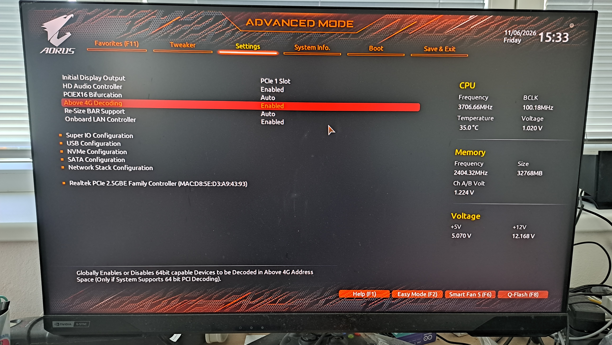

# Debugging Steam and Intel Arc Graphics on CachyOS: A Resizable BAR Story

Sometimes a software problem is not really a software problem.

This story started with Steam crashing on my CachyOS installation. Or, more precisely, Steam itself appeared to work, but several `steamwebhelper` processes were crashing in the background.

At first, this looked like a typical Linux desktop problem: perhaps Steam, Chromium, Wayland, VA-API, Mesa, or one of the many layers between them.

It turned out that the trail eventually led somewhere I did not expect.

My BIOS.

## The system

For context, this is the relevant hardware and software configuration:

- **Operating system:** CachyOS
- **GPU:** Intel Arc B580 12 GB
- **Motherboard:** Gigabyte B550M AORUS PRO-P
- **GPU kernel driver:** `xe`
- **Graphics stack:** Mesa and Intel's open-source Linux drivers
- **Boot setup:** Dual boot with Windows 11

The dual-boot part will become important later.

## Steam was working... and crashing

Steam could start normally, but `coredumpctl` showed a collection of crashes from `steamwebhelper`.

The interesting part was the signal:

```text
Signal: 7 (BUS) si_code: BUS_ADRERR
```

Looking at one of the coredumps revealed something more useful than just "Steam crashed":

```text
#0  libc.so.6
#1  /usr/lib/dri/iHD_drv_video.so
#2  /usr/lib/dri/iHD_drv_video.so
...
#11 libva.so.2
#12 libcef.so
```

That was my first proper clue.

`steamwebhelper` uses Chromium Embedded Framework (`libcef.so`), and Chromium can use VA-API for hardware-accelerated video processing.

The crash was happening somewhere in this chain:

```text
Steam
  ↓
steamwebhelper / Chromium
  ↓
VA-API
  ↓
Intel iHD media driver
```

So instead of continuing to poke at Steam, I decided to test VA-API directly.

## `vainfo` was crashing too

The standard tool for checking VA-API is `vainfo`.

Running it gave me this:

```text
Trying display: wayland
fish: Job 1, 'vainfo' terminated by signal SIGBUS
```

That was already interesting.

I tried explicitly selecting Intel's `iHD` driver:

```bash
LIBVA_DRIVER_NAME=iHD vainfo
```

Same crash.

Maybe Wayland was involved? I tried going directly through DRM:

```bash
LIBVA_DRIVER_NAME=iHD vainfo --display drm
```

Still:

```text
SIGBUS
```

At this point, I knew the problem was not just Steam.

Something lower in the graphics stack was unhappy.

## Going deeper with GDB

This is where Linux started to earn some serious respect from me.

I could simply run the failing program under GDB:

```bash
gdb --args vainfo
```

After running the program and getting the crash, the backtrace showed:

```text
Program received signal SIGBUS, Bus error.
```

And more importantly:

```text
#0  __memset_avx2_unaligned_erms
#1  /usr/lib/dri/iHD_drv_video.so
#2  /usr/lib/dri/iHD_drv_video.so
...
#11 __vaDriverInit_1_24
#12 vaInitialize
```

The Intel media driver was clearly involved.

The installed package was:

```text
intel-media-driver 26.2.4-1.1
```

However, I did not immediately start reinstalling drivers or randomly changing packages.

Before changing anything, I wanted to understand whether the rest of the GPU was working.

## Vulkan and OpenGL were fine

This made the problem even more confusing.

Vulkan worked correctly and detected the Intel Arc B580:

```text
deviceName         = Intel(R) Arc(tm) B580 Graphics (BMG G21)
driverName         = Intel open-source Mesa driver
driverInfo         = Mesa 26.1.6
```

OpenGL also reported full hardware acceleration:

```text
direct rendering: Yes
Vendor: Intel
Device: Mesa Intel(R) Arc(tm) B580 Graphics (BMG G21)
Accelerated: yes
Video memory: 12216MB
```

The kernel was using Intel's modern `xe` driver:

```text
Kernel driver in use: xe
Kernel modules: xe
```

So the GPU was definitely working.

Games worked.

Vulkan worked.

OpenGL worked.

But VA-API crashed.

This was an important reminder that a modern graphics stack is not one single thing. Rendering, display output, video decoding and other acceleration paths can all involve different parts of the driver stack.

"The GPU works" does not necessarily mean that *everything* related to the GPU works.

## The kernel log gave me a clue

Next, I looked at the kernel messages:

```bash
sudo dmesg | grep -Ei 'xe|i915|drm|bmg|battlemage|gpu|firmware'
```

One section stood out:

```text
xe 0000:08:00.0: [drm] Attempting to resize bar from 256MiB -> 16384MiB
xe 0000:08:00.0: [drm] Can't resize VRAM BAR - platform support is missing.
xe 0000:08:00.0: [drm] Small BAR device
```

That looked suspicious.

My Arc B580 has 12 GB of VRAM, but the system was exposing only a small 256 MB PCIe BAR window.

The GPU itself supported Resizable BAR. I verified that with:

```bash
sudo lspci -vv -s 08:00.0 | grep -i -A3 -B2 'Resizable BAR'
```

The output showed:

```text
Capabilities: [420 v1] Physical Resizable BAR
    BAR 2: current size: 256MB
    supported: 256MB 512MB 1GB 2GB 4GB 8GB 16GB
```

The hardware was capable of using Resizable BAR.

It just wasn't doing so.

## Finding the motherboard from Linux

Before diving into the BIOS, I wanted to confirm the exact motherboard model.

Linux made that easy too:

```bash
sudo dmidecode -t baseboard | grep -E 'Manufacturer|Product Name|Version'
```

The result:

```text
Manufacturer: Gigabyte Technology Co., Ltd.
Product Name: B550M AORUS PRO-P
```

Now I had a much clearer picture:

```text
Intel Arc B580
      ↓
GPU supports Resizable BAR
      ↓
Linux driver attempts to resize BAR
      ↓
BIOS/platform does not provide the configuration
      ↓
"Small BAR device"
```

Time to reboot.

## The fix was in the BIOS

I went into the BIOS and enabled the two relevant options required for Resizable BAR support.



I changed **Above 4G Decoding** and **Resizable BAR**  options to the state as seen on photo and after saving the changes and rebooting back into CachyOS, I checked the BAR configuration again:

```bash
lspci -vv -s 08:00.0 | grep -i -A3 -B2 'Resizable BAR'
```

This time:

```text
ATSCap: Invalidate Queue Depth: 00
ATSCtl: Enable+, Smallest Translation Unit: 00
Capabilities: [420 v1] Physical Resizable BAR
    BAR 2: current size: 16GB, supported: 256MB 512MB 1GB 2GB 4GB 8GB 16GB
Capabilities: [400 v1] Latency Tolerance Reporting
    Max snoop latency: 1048576ns
```

That was exactly what I wanted to see.

The BAR had gone from:

```text
256MB
```

to:

```text
16GB
```

The kernel log also looked much healthier, without the earlier `Small BAR device` warning.

## And suddenly, VA-API worked

After the reboot, I ran:

```bash
vainfo
```

No crash.

Instead, I got:

```text
vainfo: VA-API version: 1.24
vainfo: Driver version: Intel iHD driver for Intel(R) Gen Graphics - 26.2.4 ()
```

VA-API was working and reporting support for modern codecs including H.264, HEVC, VP9 and AV1.

The same driver that had previously crashed with `SIGBUS` was now initializing normally.

Steam also worked normally without the workaround I had experimented with earlier:

```bash
LIBVA_DRIVER_NAME=none steam
```

That workaround was no longer necessary.

## The unexpected bonus: Windows 11 got faster too

Here is where the story became even more interesting.

I dual boot this PC with Windows 11.

Before fixing the BIOS settings, I had already played games such as **S.T.A.L.K.E.R. 2** and **Cyberpunk 2077** on Windows. They worked, although the performance was not particularly impressive.

After enabling Resizable BAR, I booted into Windows and tried the games again.

They ran **noticeably better**.

That makes perfect sense in retrospect. The BIOS configuration was not a Linux-specific setting. Windows had been using the same hardware with the same limited BAR configuration.

So a problem that I originally discovered because Steam was crashing on Linux ended up improving my Windows gaming performance as well.

## A small tribute to Linux

I want to give Linux some credit here.

Windows did not tell me that something was wrong with my Resizable BAR configuration.

It did not give me an obvious trail from:

```text
Application problem
        ↓
Graphics subsystem
        ↓
Driver
        ↓
Kernel
        ↓
Hardware configuration
```

On Linux, I could investigate each layer with relatively straightforward tools.

Steam was crashing? Check the coredumps:

```bash
coredumpctl info <PID>
```

VA-API looked suspicious? Test it directly:

```bash
vainfo
```

The GPU driver might be involved? Check the kernel logs:

```bash
sudo dmesg
```

Want to inspect the PCIe configuration?:

```bash
lspci -vv
```

Need to know which motherboard I actually have?:

```bash
sudo dmidecode
```

And when `vainfo` crashed, I could simply attach GDB and get a backtrace.

That is one of the things I genuinely appreciate about Linux.

The system can be complicated, absolutely. Sometimes frustratingly so.

But the tools are there.

The layers are visible.

And if you are willing to follow the evidence, you can often trace a problem much further than you would expect.

In this case, a Steam crash eventually led me all the way into my motherboard BIOS.

## What I learned

This debugging session started with what looked like a Steam problem.

The actual path looked more like this:

```text
Steam crashes
    ↓
steamwebhelper coredumps
    ↓
VA-API
    ↓
Intel iHD media driver crashes with SIGBUS
    ↓
Check the rest of the graphics stack
    ↓
Vulkan and OpenGL work
    ↓
Check kernel logs
    ↓
"Small BAR device"
    ↓
Check PCIe Resizable BAR configuration
    ↓
256 MB BAR detected
    ↓
Enable Resizable BAR in BIOS
    ↓
16 GB BAR detected
    ↓
vainfo works
    ↓
Steam works normally
    ↓
Windows games perform noticeably better too
```

I cannot say with absolute certainty that Resizable BAR was the only root cause of the VA-API crash.

What I can say is that on this particular system, enabling it changed the BAR configuration from 256 MB to 16 GB, removed the small BAR condition, made `vainfo` work again, and allowed Steam to run normally.

That is a pretty convincing result.

## Conclusion

The fix was not reinstalling Steam.

It was not switching desktop environments.

It was not abandoning Wayland.

It was not randomly downgrading graphics drivers.

The fix was in the BIOS.

And the most satisfying part is that the investigation did not just solve one Linux problem. It also improved the performance of the same GPU under Windows 11.

So this ended up being a good reminder of something I occasionally forget:

> When debugging software, don't assume the problem is software.

Sometimes the application is just the first place where a deeper problem becomes visible.

And sometimes a Steam crash is really your motherboard asking for a BIOS setting.
