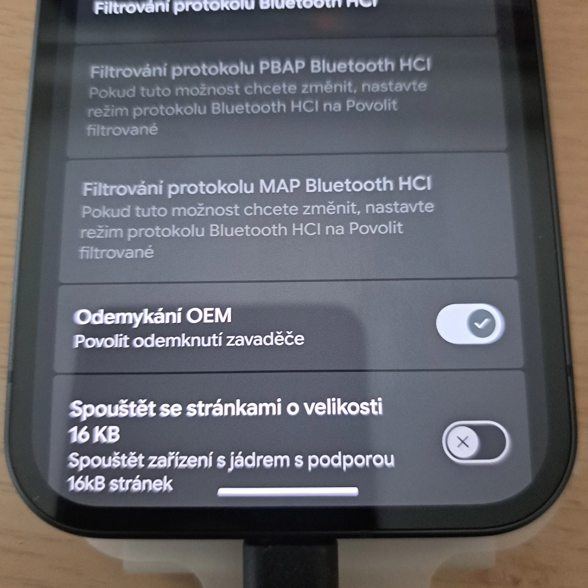
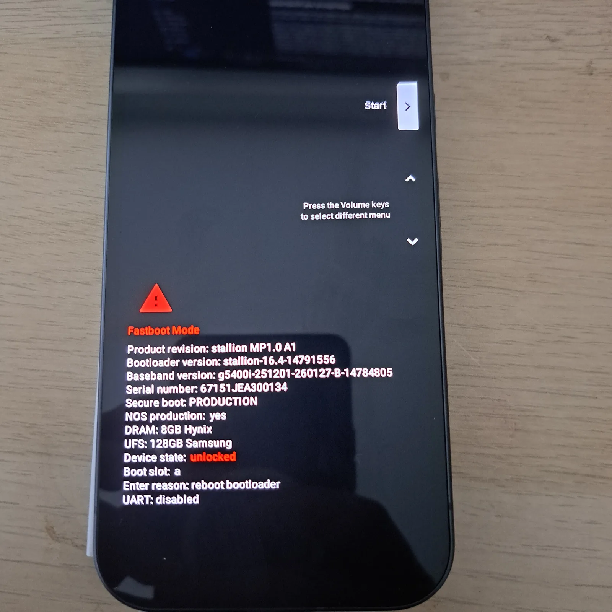
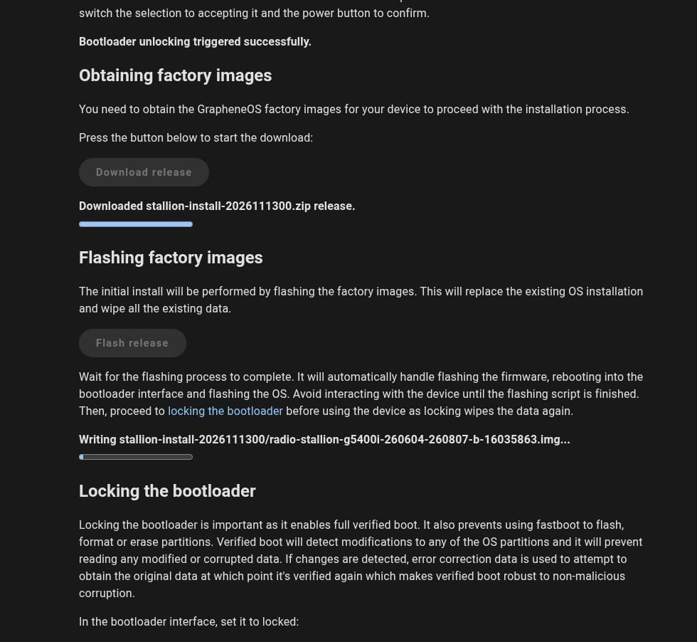
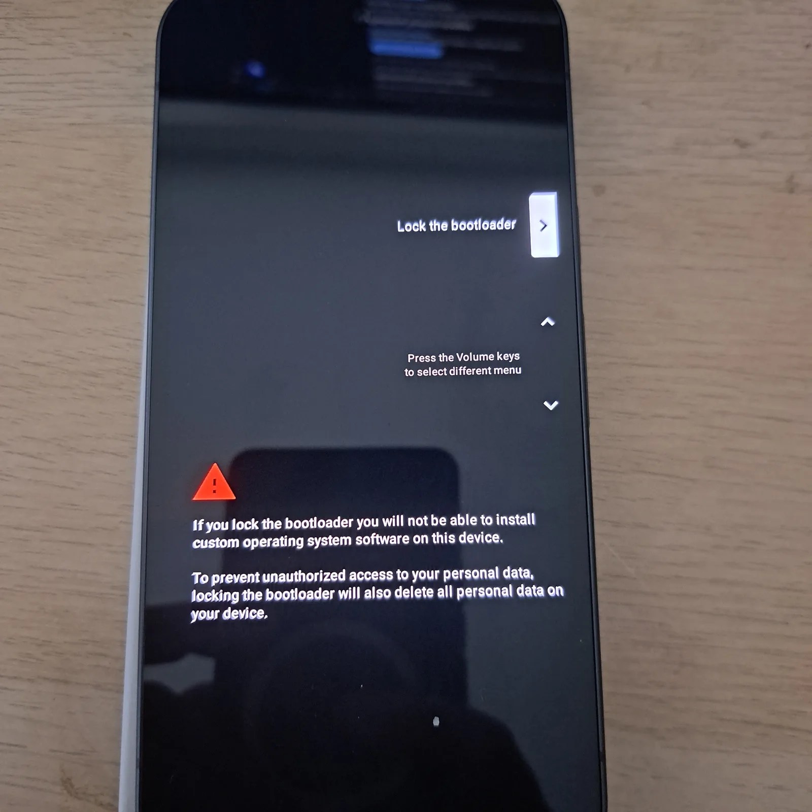
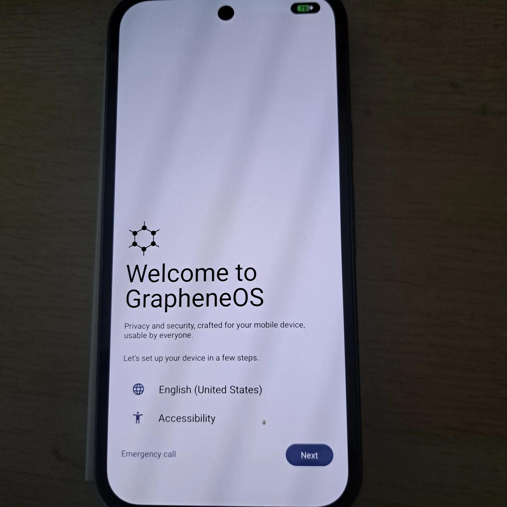
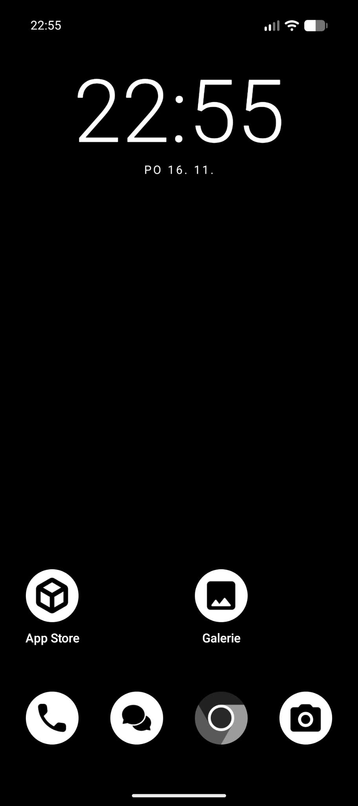

Migrating from standard Android to GrapheneOS isn't just about flashing another custom ROM. It's a shift in how you handle app permissions, Google services, and the trade-offs between privacy and convenience. Here is a complete walkthrough of installing GrapheneOS on a new Google Pixel 10a from Arch Linux (CachyOS), along with fixes for the initial post-install quirks.

## 1. Preparing Linux (Arch / CachyOS)

The official GrapheneOS web installer uses **WebUSB** directly in Chromium-based browsers (Chromium/Brave). On Arch Linux, a regular user lacks permissions to access the phone's USB interface until the proper `udev` rules are installed.

Install the package and add your user to the `adbusers` group:

```bash
sudo pacman -S android-udev
sudo usermod -aG adbusers $USER
sudo udevadm control --reload-rules
sudo udevadm trigger
```

> Log out and log back in to ensure the `adbusers` group membership takes effect.
{: .prompt-tip }

## 2. Flashing via WebUSB

1. **Prepare the phone:** Go to *Settings > About phone* and tap *Build number* 7 times. In *Developer options*, enable **OEM unlocking** and **USB debugging**.



2. **Launch the installer:** Connect the phone using a reliable USB-C cable, open [grapheneos.org/install](https://grapheneos.org/install/) in a Chromium-based browser, and pair the device.
3. **Unlock the bootloader:** Click *Unlock bootloader* and confirm the prompt directly on the phone screen using the volume and power buttons.



4. **Flash the OS:** Click *Download release* followed by *Flash release*. The installer handles all partitions automatically.



5. **Lock the bootloader:** Once flashing finishes, click *Lock bootloader* and confirm on the phone. This restores full Verified Boot integrity.





> If anything goes wrong during the process, reverting to stock Android on a Pixel is straightforward. Boot into Fastboot mode, remove the non-stock GrapheneOS signing key via the web installer, and flash the factory image using Google's official *Android Flash Tool*.
{: .prompt-info }



## 3. Sandboxed Google Play and Fixing Sync

GrapheneOS ships without Google services by default, but allows installing them as standard unprivileged apps inside an isolated user sandbox. They have no special system permissions and can be restricted from network or sensor access at any time.

1. Open the pre-installed **Apps** client and install **Google Play Services** and **Google Play Store** (Google Services Framework is now bundled directly within them on modern Android versions).
2. Go to *Settings > Passwords & accounts* and add your Google account.

### Quirk: Missing Contacts and Calendar Sync
After adding the account, Contacts and Calendar toggles won't appear in the sync menu. By default, GrapheneOS denies Google Play Services access to these data types.

**Fix:**
1. Go to *Settings > Apps > Google Play Services > Permissions*.
2. Manually grant access to **Contacts** and **Calendar**.
3. **Reboot the phone** — sync adapters only initialize properly after a restart.

## 4. Find My Device

To get remote device tracking working, simply signing in isn't enough:
1. Go to *Settings > Apps > Google Play Services > Permissions > Location*, set it to **Allow all the time**, and enable **Use precise location**.
2. Under *Battery*, set Play Services to **Unrestricted** so the system doesn't put it to sleep in the background.
3. Go to *Settings > Security & privacy > More security & privacy > Device admin apps* and activate **Find My Device**.

*Limitation:* Because Play Services run inside a user sandbox without low-level firmware privileges, offline finding (locating the phone when powered off or out of battery) does not work. The device must be turned on.

## 5. Google Pay and Banking Apps

* **Banking apps (Air Bank, Fio, UniCredit, Revolut):** Work without issues. GrapheneOS passes `BASIC` and `DEVICE` Google Play Integrity checks, which satisfies standard banking security requirements.
* **Card payments (online & in-app):** Standard card payments and 3D Secure confirmations work normally.
* **Google Pay / Google Wallet:** **Throws an insufficient device security error.** Google enforces hardware-backed `MEETS_STRONG_INTEGRITY` attestation (which no alternative OS can pass) and blocks Google Pay/Wallet operations with a security warning. Workarounds include paying directly by card details, using a bank's native HCE wallet (e.g., Air Bank), Garmin Pay on a smartwatch, or carrying a physical card.

## 6. App Installation and Update Strategy

Instead of pulling everything from a single source, splitting apps across three channels keeps the setup clean and maintainable:

1. **Google Play Store (signed in):** Strictly for apps tied to your Google ecosystem (Drive, Photos), banking apps requiring Play Integrity, and paid apps. Updates run automatically in the background.
2. **Aurora Store (anonymous mode):** For everyday commercial apps (WhatsApp, local transit, parcel lockers, auth tokens) that don't require your Google account, but still rely on background Google Play Services for push notifications (FCM).
3. **Obtainium / F-Droid:** For open-source software (Signal, Bitwarden, Proton Mail/VPN, Syncthing, Organic Maps). Obtainium pulls APKs and updates directly from official GitHub/GitLab releases without intermediaries.


